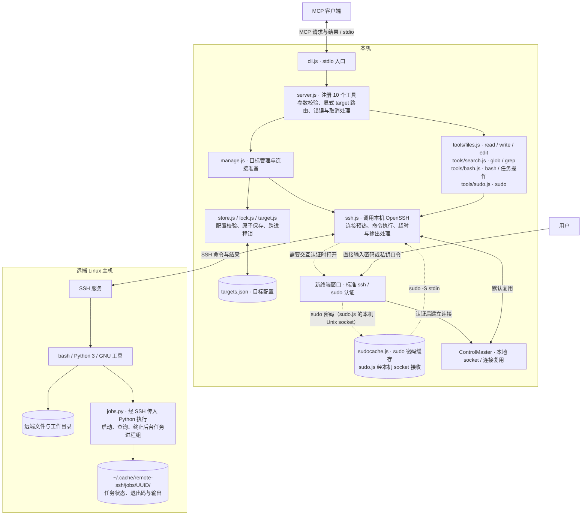

# remote-ssh MCP

remote-ssh MCP 是基于 OpenSSH 的 Model Context Protocol（MCP）服务，通过 stdio 提供远端 Linux 主机的文件读写、内容检索、命令执行和后台任务管理功能，方便 MCP 客户端直接把远端主机当成工作区使用。

服务不依赖预装远端 agent：前台操作由每次本机 `ssh` 调用完成，连接复用与认证由本机 OpenSSH 处理；后台任务会在远端按任务启动一次性 worker 进程，任务结束或清理后退出。SSH 密码与私钥口令仅在新开的终端窗口中输入，既不经过 MCP 参数，也不写入配置文件。sudo 密码同样在终端中输入，随后只在 MCP 进程内存中保留有限时间（默认 20 分钟），用于避免重复提示。

## 主要特性

- **多目标**：支持配置多个 SSH 目标；每次工具调用显式指定 `target`，不存在全局“当前主机”。
- **完整的工作区工具集**：提供 `read`、`write`、`edit`、`glob`、`grep`、`bash` 与后台任务工具。
- **连接复用**：默认复用 OpenSSH ControlMaster 连接，认证一次后可在连接保留期内复用。
- **远端免安装**：远端只需标准 Linux 环境，无需部署任何服务组件。
- **后台任务持久化**：任务在远端独立运行，MCP 进程重启后仍可查询与管理。
- **可提权执行**：`sudo` 工具以 root 运行单条命令；优先使用免密 sudo 或远端票据，否则在本机新终端输入一次密码，并在内存中缓存 20 分钟（可配置），不会反复弹窗，也不会把密码写入磁盘、日志或工具参数。

## 架构



MCP 客户端通过 stdio 调用 `cli.js`。`server.js` 注册工具、校验参数并按 `target` 路由；`manage.js` 负责目标管理与连接准备；`store.js`、`lock.js` 与 `target.js` 负责配置校验、原子保存与跨进程互斥；`tools/` 生成远端命令；`ssh.js` 调用本机 OpenSSH。远端由 SSH 服务、bash、Python 3 与 GNU 工具执行命令，后台任务由 `jobs.py` 管理。

普通工具先解析目标并准备连接，再执行远端操作。SSH 密码与私钥口令只交给终端中的 OpenSSH，不经过 MCP。sudo 密码由终端经 `src/sudo.js` 的本机 Unix socket 交给服务，并存入 `sudocache.js`，只在进程内存中保留到缓存到期（默认 20 分钟），不会写入文件、日志、工具结果或 argv。默认启用连接复用；`controlPersist: 0` 时每次调用建立独立连接，仅支持免交互认证。后台任务与日志保存在远端，独立于本机 MCP 进程的生命周期。

## 运行要求

### 本机

- Node.js 20.11 或更高版本
- OpenSSH 6.8 或更高版本（`ssh -G`；共享 ControlMaster 使用 `ControlPath %C`）
- 用于交互式认证的图形会话（无图形会话时需配置免交互认证）
- 本机 `bash`（终端认证命令与 sudo 密码提示脚本使用；macOS 自带的 3.2 即可）
- Linux 桌面或 macOS；Windows 需在 WSL 中运行，并配置可用的终端启动命令

### 远端

- Linux
- bash 与 POSIX `sh`
- Python 3.9 或更高版本
- GNU coreutils 8.25 或更高版本（grep 管道使用 `head -z`）、`base64` 与 `grep`
- 后台任务依赖 Linux `/proc`
- `sudo` 工具要求远端允许无 tty 执行 sudo（sudoers 未启用 `requiretty`）；密码路径要求 `timestamp_timeout` 非 0，免密路径要求 `NOPASSWD` 覆盖 `sudo -n -v` 与包装命令 `bash`（通常是 `NOPASSWD: ALL`）

### 兼容性说明

本服务使用 SSH 的非交互命令通道。远端账户必须允许执行命令，并能够访问 `sh`、`base64` 与目标目录。仅支持 SFTP、仅允许交互式 TTY，或强制菜单/受限命令的账户不能用作通用远程工作区；服务不会绕过服务端的权限限制。原生 Windows 与 macOS 远端不在支持范围内。

## 安装

```sh
cd remote-ssh
npm ci
node src/cli.js --help
```

服务没有构建步骤。运行期间，stdout 仅用于 MCP 协议，日志与错误输出到 stderr。

在支持 stdio 的 MCP 客户端中，将启动命令设为 `node`，参数设为 `src/cli.js` 的绝对路径：

```json
{
  "mcpServers": {
    "remote-ssh": {
      "command": "node",
      "args": ["/absolute/path/to/remote-ssh/src/cli.js"]
    }
  }
}
```

使用自定义配置文件时，追加 `--targets /absolute/path/to/targets.json`。SDK 接入方式参见[官方 stdio 文档](https://github.com/modelcontextprotocol/typescript-sdk/blob/main/docs/get-started/first-server.md)。

## 核心概念

### 目标与 root

目标（target）是一条命名的 SSH 连接配置。每次工具调用通过 `target` 字段显式选择目标；相对路径基于该目标的 `root` 解析，绝对路径直接指向远端。`root` 是默认工作目录，不是访问沙箱；命令以 SSH 账户的权限执行。

### 目标配置

默认配置文件为 `~/.config/remote-ssh/targets.json`，文件不存在时目标列表为空。配置可手工编辑，也可通过 `remote_ssh_targets` 工具维护。服务在每次调用时重新读取配置；文件损坏时会报错，并保持原文件不变。写入采用临时文件加原子替换，并受跨进程锁保护，文件权限为 `0600`。配置严格接受以下五个字段：

```json
[
  {
    "name": "gpu",
    "ssh": "user@gpu.example.com",
    "port": 22,
    "root": "/home/user/project",
    "controlPersist": 43200
  }
]
```

- `name`（可选）：目标名称，必须唯一；省略时使用规范化后的 SSH 目标。
- `ssh`（必填）：`~/.ssh/config` 中的别名或 `user@host`。支持 `user@host:2222` 与 `user@[::1]:2222`；裸 IPv6 地址的端口用 `port` 指定。该字段不接受整条 shell 命令，也不接受密码。
- `port`（可选）：SSH 端口覆盖；`port: null` 会清除它。更新时重复传入相同的 `ssh` 不会丢弃已有端口；改变 `ssh` 且未显式提供端口时，旧端口覆盖会被清除，避免把旧主机的端口带到新别名。若同一次更新中 `ssh` 自带内联端口而 `port` 为 `null`，以内联端口为准。
- `root`（必填）：远端绝对路径，不接受 NUL、`..` 路径段或不成对的 UTF-16 代理项（`name` 同样不接受后者）。
- `controlPersist`（可选）：连接复用保留时间，单位为秒，默认 43200（12 小时），上限 31536000；`0` 或 `null` 禁用连接复用。

### 连接复用

服务使用 OpenSSH 的 ControlMaster 与 ControlPersist 复用连接。同一 SSH 目的地（包括指向同一连接的不同别名）共享一条连接与一次认证结果，连接默认保留 12 小时。

连接复用沿用本机 OpenSSH 配置，包括 `Host` 别名、`HostName`、`User`、端口、`IdentityFile`、证书、`IdentityAgent`、`ProxyJump`、`ProxyCommand` 与认证方式。若日常使用 `ssh -i ... -J ... -p ...` 登录，应将这些参数写入 `~/.ssh/config` 的独立别名，再将该别名作为目标的 `ssh` 字段。

命令通道与终端认证连接使用相同的服务端保活策略（默认 `ServerAliveInterval=30`、`ServerAliveCountMax=3`），可用 `REMOTE_SSH_SERVER_ALIVE_INTERVAL` 与 `REMOTE_SSH_SERVER_ALIVE_COUNT_MAX` 调整；经过跳板机或 NAT 时保持一致，避免两种认证路径出现不同的断链表现。保活只能发现失联，不能证明远端命令健康，因此失败的、可能有副作用的命令仍不自动重试。

MCP 命令通道会关闭 `RemoteCommand`、TTY、`StdinNull` 与自动后台化，清除端口转发，并禁用 agent/X11 转发与本地命令（`ForwardAgent`、`ForwardX11`、`ForwardX11Trusted`、`PermitLocalCommand`），同时保留 `ProxyJump`、`ProxyCommand` 路由与身份配置。服务不会修改用户的 SSH 配置文件或既有转发。若原先通过 `RemoteCommand` 进入容器或另一台主机，应为目标配置直接到达该环境的 SSH 别名。

远端命令编码为单行后由 POSIX `sh` 解码执行，不依赖登录 shell 的多行语法、引号或历史展开规则；文件内容通过标准输入传输。非交互 shell 的启动脚本不应向 stdout 输出内容，以免干扰结构化结果。

### 认证

连接准备按以下顺序进行：

1. 检查目标是否已有可复用的 ControlMaster 连接。
2. 尝试已配置的密钥或 ssh-agent。主机密钥必须已知。
3. 当需要确认主机指纹、输入密码或解锁私钥时，在 MCP 进程所在本机的新终端中运行标准 `ssh`。用户直接与 OpenSSH 交互，服务不接收也不保存这些输入。
4. 认证成功后，SSH 连接转入后台，终端中的命令结束；后续调用复用该连接。

目标的 `add`、`update`、`connect` 以及所有远程工具均使用此流程。并发调用共享同一次连接准备，取消单次调用不会破坏其他调用正在等待的认证。主机密钥验证保持开启，服务不会自动接受未知或变化的主机密钥，也不会自动启用旧算法。

终端在新窗口打开，需要图形会话及相应环境变量（例如 `DISPLAY`、`WAYLAND_DISPLAY`、`DBUS_SESSION_BUS_ADDRESS`）。服务会自动探测常见 Linux 终端，也可通过 `REMOTE_SSH_TERMINAL` 显式指定：

```json
{
  "mcpServers": {
    "remote-ssh": {
      "command": "node",
      "args": ["/absolute/path/to/remote-ssh/src/cli.js"],
      "env": {
        "REMOTE_SSH_TERMINAL": "gnome-terminal --window -- bash -lc"
      }
    }
  }
}
```

`REMOTE_SSH_TERMINAL` 指定终端可执行文件及其参数，服务会把要运行的完整命令（SSH 命令或 shell 脚本）作为最后一个参数追加；其中不应包含密码。默认等待输入 150 秒；多个 MCP 进程争用同一预热锁时，连接准备最多再等待 200 秒。客户端的单次工具超时应覆盖连接准备与认证（建议不低于 400 秒），或改用后台模式。禁用连接复用或缺少图形终端时，需预先配置可用的免交互密钥或 ssh-agent 认证。

## 工具

| 工具 | 作用 |
| --- | --- |
| `remote_ssh_targets` | 目标的 `list` / `add` / `update` / `remove` / `connect` / `disconnect` / `status` |
| `read` | 分页读取远端 UTF-8 文本并显示行号 |
| `write` | 创建或完整覆盖文本文件，采用原子替换 |
| `edit` | 字面量替换；文件大小上限 4 MiB，写回前校验 inode/mtime/ctime/size |
| `glob` | 按 glob 模式匹配文件路径，最多返回 100 项 |
| `grep` | POSIX 扩展正则搜索，最多返回 250 条 / 512 KiB |
| `bash` | 前台命令或后台任务；前台默认 120 秒，上限 600 秒 |
| `sudo` | 以 root 执行单条前台命令；密码在进程内存中缓存 20 分钟 |
| `job_output` | 任务状态与输出分页，以及结束后的清理 |
| `job_kill` | 向任务进程组发送 SIGTERM，必要时 3 秒后发送 SIGKILL |

### 目标管理

`remote_ssh_targets` 通过 `action` 字段执行操作。`add` 与 `update` 会验证远端连通性与 `root` 目录，并在需要时触发交互式认证；仅当 `create: true` 时创建缺失的 `root` 目录：

```json
{"action":"add","name":"gpu","ssh":"gpu-alias","root":"/data/project","create":true}
```

`update` 与 `connect` 通过 `target` 指定现有名称。更新时可通过 `name` 改名，通过 `port: null` 清除端口覆盖；仅重复传入相同的 `ssh` 不会丢弃已有端口。删除配置不会删除远端文件，也不会终止正在运行的任务。指向同一 SSH 目的地的多个目标共享连接，因此 `disconnect` 会影响它们的连接复用：

```json
{"action":"connect","target":"gpu"}
```

### 文件

`read` 分页读取 UTF-8 文本，返回带行号的内容，默认从第 1 行开始，最多 2000 行：

```json
{"target":"gpu","file_path":"README.md","offset":1,"limit":100}
```

`read` 单次最多返回 2000 个完整行和 1 MiB。文件不超过 8 MiB 时返回精确总行数；更大的文件通常只扫描到请求窗口结束并返回 `total_lines: null`，若请求窗口已到达文件末尾则仍返回精确总数。因字节上限提前结束时，末尾会提示截断并给出准确的续读 `offset`，不会把截断后的首个完整行标成错误的行号；单行（含换行符）超过 1 MiB 时，如果它是返回窗口的第一行则拒绝读取并提示改用 `bash`，否则窗口在该行前停止并标记截断。FIFO/设备/目录等非普通文件以 `O_NONBLOCK` 打开并立即 `fstat` 拒绝，不会阻塞。若远端输出超过传输上限而被截断，该调用会以明确错误返回，不会把截断内容当作完整文件内容。

`write` 创建或完整覆盖文件，父目录会自动创建。内容以原始字节经 stdin 上传，远端在替换前校验字节数与 SHA-256；提前 EOF、多余字节或等长损坏都会失败，原文件保持不变。替换时先写同目录临时文件再原子改名，新文件权限为 `0600`，已有文件保留原权限位，权限复制失败即中止。符号链接会被跟随（写入真实目标，链接本身保留）；已存在的非普通文件会被拒绝。内容上限为 8 MiB 的 JSON 编码请求（MCP stdio 单条消息上限 10 MiB）。这只是原子替换与上传完整性校验，不是文件锁，也不保证掉电后的持久性。

`edit` 按字面量替换文本，`replace_all` 为 `false` 时 `old_string` 必须唯一。匹配、替换和原子写回在远端一次 SSH 调用内完成，只上传新旧字符串，不用整文件往返传输；文件与结果不得超过 4 MiB，新旧字符串合计不得超过 8 MiB 的 JSON 请求。符号链接同样会被跟随。写回前会核对 inode、mtime、ctime 与文件大小，检测到并发修改时拒绝覆盖并要求重新读取。这项检查不是锁，不遵守此协议的写入进程仍可能造成竞争。`read` 只校验返回窗口内的字节，`edit` 校验整个文件；两者都拒绝 NUL 与无法解码的内容。

### 搜索

`glob` 按 glob 模式匹配文件路径，不返回目录，结果按修改时间倒序，最多 100 项。`\` 转义下一个字符（`\*` 匹配字面 `*`，`\\` 匹配反斜杠），转义字符不计入预算；未闭合的 `{` 按字面处理，嵌套 `{...}` 会报错，字面 `{`/`}` 用 `\{`/`\}`。为避免正则回溯爆炸，一个模式最多包含 1 个 `**` 片段、4 个 `*`/`?` 通配符与 2 个 `{...}` 交替；超出会明确拒绝。模式不含 `/` 时匹配任意深度的文件名；`.git`、`.svn`、`.hg` 与 `node_modules` 目录会被跳过。结果在内部以 NUL 分隔，因此文件名中的换行不会破坏结构；无法用 UTF-8 表示的文件名会被跳过。文件名本身含换行时，返回文本会原样显示，阅读时可能看起来像两行。不可读的目录或不存在/非目录的路径会返回错误，而不是当作没有匹配。glob 与 grep 的 SSH 请求超时为 120 秒，不包含前置连接准备。

`grep` 使用 POSIX 扩展正则搜索文件内容，按文件分组返回带行号的结果，最多 250 条，编码后的输出上限 512 KiB；超长行会被缩短并标注（不会拆开代理对），整个返回结果在本地截断前必须低于 4 MiB 传输上限；文件名不是合法 UTF-8 或无法解析的记录会被跳过并计数，匹配文本中的非 UTF-8 字节会显示为替换字符；文件名本身含换行时，返回文本同样可能看起来像多行。`include` 可用于限定文件名模式；`.git` 与 `node_modules` 目录以及二进制文件会被跳过。远程 `head` 缺少 `-z` 时会明确报错，而不是返回“无匹配”。

### 命令执行

`bash` 在远端执行命令，每次调用启动新的 shell，命令以 SSH 账户的权限运行。前台命令默认超时 120 秒，上限 600 秒；stdout 保留尾部 512 KiB、stderr 保留尾部 64 KiB，超出时在结果中标注截断。编码后的命令超过 96 KiB 单个 SSH 参数上限时会被拒绝，应改用后台任务或先把脚本写入远端文件。`run_in_background: true` 时改为启动持久后台任务。

### 提权执行（sudo）

`sudo` 在远端以 root 权限执行单条前台命令。执行顺序：

1. **免密探测**：先单独运行 `sudo -n -v`，不执行任何用户命令。成功（`NOPASSWD` 或仍有效的全局 sudo 票据）时，命令在第二次 SSH 调用中以 `sudo -n` 执行，不需要密码，也不会打开终端。探测不跑用户代码，因此其结果无法被命令伪造，也不会造成重复执行。
2. **内存缓存**：需要密码时，按 SSH 目的地复用最近一次输入的密码。默认从输入时刻起保留 20 分钟（绝对值，不使用滑动续期）；到期后不再可读，并由定时器或下一次访问清零（`REMOTE_SSH_SUDO_CACHE_MS` 超过约 24.8 天时只有惰性清零）。设为 `0` 关闭缓存。
3. **终端提示**：缓存未命中时，在运行 MCP 服务的本机新开终端。提示会显示目标名与配置的 SSH 目的地（别名或 `user@host`）及其端口，控制字符会被替换。密码用 `read -s` 静默读入，经 `src/sudo.js` 的本机私有 Unix socket（0700 临时目录）交给 MCP 进程。

密码只发送给 `sudo -S -v` 做认证，该调用同样不执行用户命令；随后 `sudo -n -v` 复核票据。如果 sudo 因票据或 `NOPASSWD` 没有读取密码，SSH stdin 上残留的一行会由短生命周期的 `bash` 在命令启动前消费掉（drain 自身失败会中止，不运行命令）。命令在同一个远端 shell 中通过 `sudo -n` 执行，stdin 为 `/dev/null`；认证调用与命令是同一个子 shell 的子进程，因此默认的 ppid 票据仍然有效。因此：

- 用户命令无法从祖先进程的 stdin 管道读回密码；
- 认证阶段只运行 `-v`，命令每次调用最多执行一次，且认证失败时不会自动重试；
- 命令的语法错误、信号退出或非零退出码都是普通结果，不会被误判为认证失败（START/POST 标记证明命令确实启动过）。

密码不会写入文件、日志、工具参数、工具结果或 argv，也不会被回显；MCP 进程只在缓存有效期内持有内存副本（TTL 超过约 24.8 天时只有惰性清零，见上），单次调用的临时副本在 SSH 接受 stdin 后立即清零。提示显示配置的目标名、SSH 目的地与端口（不展示 `ssh -G` 解析后的实际主机名），让用户能确认密码将发往哪个配置目标。

```json
{"target":"gpu","command":"apt-get update","workdir":"/"}
```

远端 sudo 不分配 tty（`sudo -S` 从 stdin 读取密码），因此 sudoers 必须未启用 `requiretty`。密码路径还要求 sudo 保留认证票据（`timestamp_timeout` 非 0）；密码路径下 `timestamp_timeout=0` 的主机会明确报错而不是降级。若要使用免密探测，`NOPASSWD` 必须让 `sudo -n -v` 成功，并且覆盖工具实际执行的包装命令 `bash`（通常是 `NOPASSWD: ALL`）；只对目标命令授予的 `NOPASSWD` 不能授权这个包装，此时仍走密码路径并受 `timestamp_timeout=0` 限制，会报票据复核失败而不是降级。

密码被拒绝后会立即从缓存清除并返回认证失败；下一次调用会重新提示，不会在同一次调用里自动重试（避免命令被二次执行）。同一 MCP 进程内、缓存启用时，同一目的地且解析身份相同的并发调用共享一个终端；身份不同（例如某次 `ssh -G` 失败）时各自提示（关闭缓存或使用多个 MCP 进程时也各自提示）。`remote_ssh_targets` 的 `remove`、改变 `ssh`/`port` 的 `update` 以及 `disconnect` 会清除**当前 MCP 进程**中该目的地的缓存密码；其他进程的缓存按 TTL 自然到期。MCP 进程退出时也会清零。缓存按目的地（别名 + 端口）与 `ssh -G` 解析出的 host/user/port 分槽保存：修改 `~/.ssh/config` 的 HostName/User/Port 后，旧槽不再命中并会重新提示（旧槽随 TTL 到期）；若本次无法解析身份，也不会命中已绑定身份的槽；反过来，在无法解析身份时写入的条目只按别名 + 端口匹配，因此不受后续 HostName/User/Port 变化约束。同一目的地的不同身份并发时各自使用独立槽，互不覆盖。缓存最多保留 32 个目的地/身份槽，超出时优先淘汰最接近到期的条目（可能提前重新提示）。管理操作按别名 + 端口清除全部槽；ssh 客户端因 host-key 校验失败以 255 退出时会自动清除。若本地超时/取消先结束了本次调用，迟到的失败输出不再触发清除，下一次实际连接会重新校验主机密钥。

**安全边界**：密码会短暂经过远端 `sudo -v` 进程与 drain `bash` 的内存。目标主机上已有的 root 进程（包括之前以 root 运行并留下的守护进程）可以读取这些内存、替换 `sudo`/`bash`，从而捕获后续密码；这是“可以向该主机执行 root 命令”的固有后果。**同一远端账户下的任何进程**（包括通过本服务的 `bash`/后台任务启动的进程）也可以读取该 SSH 会话 stdin 管道中的密码、杀死或干扰 sudo 包装脚本；远端账户本身必须是可信的，不要在该账户上同时运行不可信任务。不要把重要账户的密码交给一个允许模型任意以 root 运行命令的主机；优先使用 `NOPASSWD`、一次性凭据或隔离账户。若目标指向本机（如 `localhost`），其 root 命令可以直接读取 MCP 进程内存中的缓存。本机同一用户的其他进程可以连接密码提示 socket（0700 目录只隔离其他用户），注入错误密码造成拒绝服务，但不会收到真实密码；它可以读取 socket 路径并抢在真实客户端之前应答。

工具仅支持前台执行，`timeoutMs` 默认 300000 毫秒、上限 600000 毫秒，覆盖探测、密码输入（含终端启动）与命令执行，但不包含前置 SSH 连接准备；密码等待最多 150000 毫秒，并受剩余预算限制。sudo 命令的 stdout 保留尾部 512 KiB、stderr 保留尾部 64 KiB，超出时在结果中标注截断。超时或取消时只会终止本机 SSH 进程，远端命令可能继续运行；仍在读取密码的终端不保证立即关闭。重试有副作用的命令前应先检查远端状态；客户端的请求超时还需覆盖前置连接准备。

## 后台任务

通过 `bash` 的 `run_in_background: true` 启动后台命令：

```json
{"target":"gpu","command":"python3 train.py","run_in_background":true}
```

调用返回 `job_id`，通过 `job_output` 查询状态与输出：

```json
{"target":"gpu","job_id":"<job_id>","offset":0,"limit":65536}
```

结果包含 `status`、`exit_code`、`output`、`next_offset` 与 `has_more`，输出合并 stdout 与 stderr。`offset` 是从 0 开始的字节偏移，不是行号；`limit` 以字节计，最小 4（足以容纳一个完整 4 字节 UTF-8 字符），默认及上限均为 65536；若 `running`/`lost` 任务的末尾只有 1–3 字节的不完整字符，`next_offset` 可能暂时不前进，直到有更多输出。将 `next_offset` 作为下一次调用的 `offset` 可无重复地继续读取；跨页的多字节 UTF-8 字符会留到下一页，不会被替换成 U+FFFD。`has_more: false` 只表示当前没有更多输出，并不表示任务已经结束，应同时检查 `status` 和 `exit_code`。

后台模式忽略 `bash.timeoutMs`，任务本身没有运行时限；启动、查询与终止任务的 SSH 请求超时均为 120 秒，不包含前置连接准备。如果启动失败信息中包含 `job_id`，应先查询该 ID，避免重复启动。

`job_kill` 使用相同的 `target` 与 `job_id`，向任务进程组发送 SIGTERM，并在 3 秒宽限期后由任务 worker 升级为 SIGKILL。升级由远端 worker 自己执行：即使 `job_kill` 的 SSH 请求在宽限期内断开或取消，终止仍会继续。命中范围是任务进程组以及同一会话内的成员，而不只是直接 shell；`set -m` 创建的新进程组、忽略 SIGTERM 的子进程也会被清理。worker 会等到组内非僵尸成员全部退出，并连续两次扫描确认为空后才完成，因此任务在仍有存活子进程时不会报告为已结束。若 worker 自身被暂停且无法运行，结果会保持 `running`；对 v3 worker，`killed` 表示 worker 接受终止并完成了收尾（确认成员已停止），若 worker 在收尾前死亡，状态为 `lost` 而不是 `killed`。主动创建新会话或守护进程的子进程仍可能脱离。输出仍可通过 `job_output` 读取；`job_kill` 的响应也包含第一块输出（offset 0，最多 65536 字节）。

对 v3 worker，若其意外死亡（没有正常收尾标记），状态为 `lost`，即使退出文件已存在：`job_kill` 返回 `worker_missing: true`，不会向可能已被复用的 PID 发信号；`job_output` 的 `warning` 提示后代可能仍在运行，且其 `cleanup` 会被拒绝，需先在远端确认。v1/v2 旧任务沿用旧的 `completed`/`killed` 判定（有退出文件且无 killed 标记即 `completed`，可清理；有 killed 标记时 `killed` 优先），但 `lost` 的清理在所有版本都会被拒绝。

任务状态与输出默认保存在远端 `~/.cache/remote-ssh/jobs/<job_id>/`。任务在 MCP 进程退出后继续运行，重启后凭相同目标与 ID 可继续查询。目标改名后需使用新名称；更改 SSH 主机后，旧任务仍保留在原主机。日志不会自动删除，也不限制磁盘占用；任务结束且当前读取块后没有更多输出时，可用 `job_output` 的 `cleanup: true` 永久删除任务记录及日志。服务不追踪此前的读取进度，调用方应先读取所有需要保留的内容。`status` 为 `completed` 仅表示进程已结束，成功与否需检查 `exit_code`。

前台命令超时或被取消时，只会终止本机 SSH 进程，远端命令可能继续运行；需要可靠终止时应使用后台任务。任务主动创建新会话或守护进程的子进程可能脱离任务进程组。

## 并发与一致性

服务支持一个或多个 MCP 进程并发访问同一台或不同主机。每个 MCP 客户端应启动独立的 stdio 服务进程，不应共用同一条 stdin/stdout。每次调用独立指定 `target` 与工作目录，不存在全局“当前 target”；sudo 凭据缓存、连接预热状态与配置锁队列都是每个 MCP 进程独立的，多进程之间不会共享。

- 在同一操作系统用户下，共用 `REMOTE_SSH_CONTROL_DIR` 的进程会按 OpenSSH 解析后的 ControlPath 协调连接准备；指向同一连接的不同别名共享已完成的认证。连接就绪后命令并行执行。认证失败后的 30 秒终端抑制缓存按目标别名 + 端口记录，因此同一连接的不同别名在该窗口内仍可能各自打开一次认证窗口。不同服务器独立认证。取消单次调用不会取消其他调用，也不会中断共享的连接准备。
- 共用配置文件时，网络检查与用户输入不占用配置锁；保存时会短暂加锁并原子替换。若目标在验证期间被其他进程修改，更新会报告冲突而不覆盖新配置，此时应重新读取后重试。锁目录的 `owner` 文件被外部改成不可读时，存活持有者不会被强行抢占；若持有进程已退出而锁仍在，可手动删除 `<store>.lock` 与 `<store>.lock.recover`。
- 后台任务使用独立 UUID。修改或删除目标配置不会影响已经开始的任务。

并发访问不提供任意并发写入的保护：多个 `write` 同时覆盖同一文件时，最后一次写入生效；`edit` 的 mtime/size 校验只能尽力检测冲突，不能替代文件锁或内容合并。多个调用方编辑同一项目时，应划分文件或使用独立工作目录。`disconnect` 会关闭共享连接，可能中断其他调用方正在执行的操作；目标改名或删除、任务终止与日志清理同属共享管理操作，需要调用方自行协调。

并发规模仍受 SSH 服务端限制。例如每条复用连接的 `MaxSessions` 默认为 10，此外还有连接数与资源限制（见 [sshd_config](https://man.openbsd.org/sshd_config#MaxSessions)）。高并发任务应由调用方限制同时运行的前台命令数量，或改为启动后台任务后轮询。服务不会自动重试可能产生副作用的命令。

## 环境变量

| 变量 | 默认值 / 用途 |
| --- | --- |
| `REMOTE_SSH_TARGETS_FILE` | `~/.config/remote-ssh/targets.json`；`--targets` 优先 |
| `REMOTE_SSH_CONTROL_DIR` | `~/.cache/remote-ssh/control`；目录权限 `0700`；路径不得包含空白、引号、`$`、`%`、`{` 或 `}`（OpenSSH `-o` 解析/展开限制） |
| `REMOTE_SSH_TERMINAL` | 终端启动命令；默认自动探测 |
| `REMOTE_SSH_SUDO_CACHE_MS` | `1200000`（20 分钟）；sudo 密码在内存中的保留时间，`0` 关闭缓存；超过约 24.8 天时只有惰性清零 |
| `REMOTE_SSH_CONNECT_TIMEOUT_MS` | `150000`；终端认证等待时间；正整数会夹取到 1000–150000 毫秒，非整数、`0`、负数或无效值回退到 `150000` |
| `REMOTE_SSH_SERVER_ALIVE_INTERVAL` | `30`；SSH 服务端保活间隔（秒），`0` 禁用，命令通道与终端认证共用 |
| `REMOTE_SSH_SERVER_ALIVE_COUNT_MAX` | `3`；连续无响应次数达到后断开，最小 1 |
| `REMOTE_SSH_LOCK_TIMEOUT_MS` | `150000`；等待配置锁的最长时间 |
| `REMOTE_SSH_LOCK_GRACE_MS` | `5000`；空锁被判定为过期前的宽限时间 |
| `REMOTE_SSH_LOCK_RETRY_MS` | `50`；配置锁重试间隔 |

SSH socket 路径过长时，可将 `REMOTE_SSH_CONTROL_DIR` 设置为较短的用户路径；该路径会作为 OpenSSH `-o ControlPath=` 的值重新解析，因此不能包含空白、引号、`$`、`%`、`{` 或 `}`。`REMOTE_SSH_JOB_DIR` 由远端 `jobs.py` 读取，必须在远端账户的非交互环境中设置（如 shell profile、`~/.ssh/environment` 或 sshd `PermitUserEnvironment`/`AcceptEnv`）。服务本身不转发环境变量；除非另行配置 ssh `SendEnv` 与 sshd `AcceptEnv`，在 MCP 进程环境中设置不会传到远端。

## 测试

```sh
npm test
```

测试使用 Node.js 内置测试运行器，覆盖 MCP 新旧协议握手、工具参数校验、目标路由、配置增删改、终端认证复用、取消传递、文件读写、配置锁与后台任务生命周期。文件用例在临时目录中执行真实远端脚本，覆盖完整行读取、续读行号、非法 UTF-8、提前 EOF、等长损坏、SHA-256 校验、权限保留、原子写回与并发修改；后台任务用例覆盖忽略 SIGTERM 的同组子进程、shell 先退出但子进程仍存活、worker 被杀后的 `lost`/清理拒绝，以及 `job_kill` 请求进程中途被杀后远端仍继续升级终止。`sudo` 用例在本地执行真实的远端包装脚本与伪 sudo，覆盖认证探测不执行用户代码、ppid 票据与 exec 优化、密码经 Unix socket 交付与内存复用、缓存绑定 `ssh -G` 解析身份、共享提示、被拒/失效密码（不在同一次调用里重试）、`timestamp_timeout=0`、策略拒绝、drain 与 drain 失败中止、命令语法错误/自杀退出/退出码保留、工作目录、超时，以及命令无法读回未消费密码的回归测试。并发用例使用多个独立进程验证同主机/别名认证合并、不同主机互不阻塞、配置冲突，以及两个 stdio 客户端的并发调用与取消隔离。兼容性用例使用本机 `ssh -G` 验证登录配置隔离、身份与跳板路由保留、保活参数一致性与校验，并检查单行脚本传输与终端启动失败处理。测试不连接真实远端；真实终端弹窗、服务器认证与网络性能仍需在使用环境中验证。

## 形式化验证

并发与安全关键协议使用 TLA+ 建模，并通过 TLC 穷举所有可达状态进行检查。覆盖目标配置锁、连接预热去重、后台任务生命周期与 sudo 密码信息流；需要 Java 11+ 与 `tla2tools.jar`：

```sh
TLA2TOOLS_JAR=/path/to/tla2tools.jar npm run verify
```

- `formal/Lock.tla`：修复后的锁协议满足互斥与闸门互斥；协议不创建空壳，遗留空壳（环境注入）始终没有 owner 记录并由恢复路径替换；
- `formal/Warmup.tla`：同一目的地在途预热至多一个，且不会并发打开认证终端或在失败缓存期内重弹终端；
- `formal/Jobs.tla`：进程存活或输出未读尽时绝不删除任务目录；模型内的定义性状态一致性（v3 的 `done`/`lost` 派生由测试覆盖）；
- `formal/Sudo.tla`：sudo 密码只出现在终端、本机 Unix socket、MCP 内存缓存、SSH stdin 与远端 sudo stdin；缓存副本有绝对截止时间，密码不进入工具结果、磁盘、日志或 argv。模型覆盖 `TTL >= 1`；每次调用的临时副本、ppid 票据、drain、固定包装标记与“命令读不回未消费密码”由 `test/sudo.test.mjs` 的本地真实包装脚本回归覆盖，不在模型范围内。

同时保留四个“反设计”对照，TLC 必须仍然反证它们，以证明模型对该性质确实敏感：`LockHuskRace.tla`（`MutualExclusion`）、`WarmupNoDedup`（`NoConcurrentTerminals`）、`JobsUnsafe`（`NoUnreadOutputLost`）、`SudoLeak`（`ObservableSecrecy`）。另有 `Lock.tla` + `LockNoHusk.cfg` 的可达性对照：反证 `NoHuskEver`，证明环境确实能注入遗留空壳，避免 `NoOwnedHusk` 变成空洞不变式。其中 `LockHuskRace` 记录了一次真实修复：创建者在 `mkdir` 与写 owner 之间停顿超过宽限期时，其按路径写入可能落入后继进程的锁目录，导致两者同时进入临界区。详见 [`formal/README.md`](formal/README.md)。

## 许可证

本项目采用 [MIT 许可证](LICENSE)。
